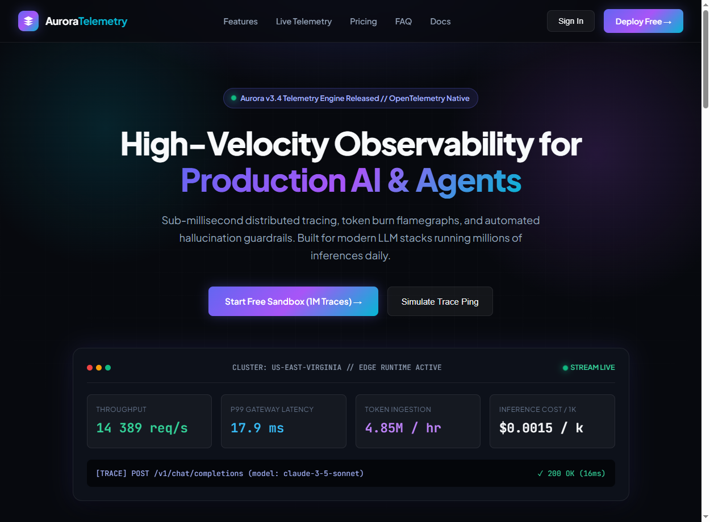
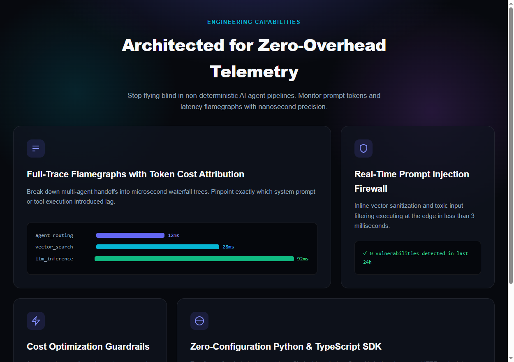
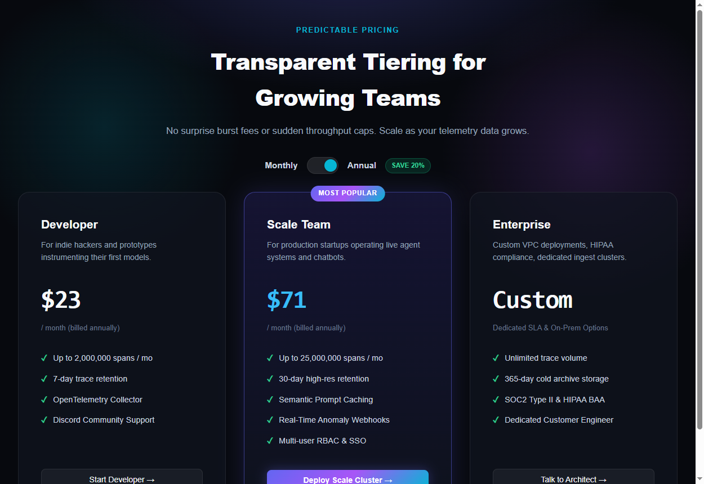

# Aurora Telemetry — AI Observability & Tracing Platform

Современный высоконагруженный лендинг для SaaS-платформы мониторинга, распределенной трассировки и оптимизации затрат на генеративные нейросети (LLM Observability & Multi-Agent Tracing).

Выполнен в эстетике **Aurora Dark Mesh / Linear & Stripe SaaS**: глубокий чернильный фон (`#07090E`), рассеянные неоновые аврора-градиенты (`#6366F1`, `#06B6D4`, `#10B981`), многослойная Bento-сетка, интерактивный HUD телеметрии и динамический калькулятор тарифов.

---

## Визуальный обзор платформы

### 1. Главный экран и интерактивный Live Telemetry Sandbox
Живой симулятор входящих трейсов в реальном времени с обновлением RPS, P99 задержки (ms), скорости сгорания токенов и стоимости инференса. Содержит интерактивную симуляцию спанов и вызовов API.



### 2. Bento Grid: Возможности платформы
Инженерная витрина функционала: визуализация водопадных Flamegraph-графиков, встроенный файрвол защиты от Prompt Injection, модуль семантического кэширования для снижения расходов на 40%+ и двухстрочный OpenTelemetry SDK.



### 3. Матрица тарифов и аккордеон FAQ
Интерактивный переключатель ежемесячной и годовой оплаты со скидкой 20%, подсветкой рекомендованного плана *Scale Team*, бейджами фичей и раскрывающимися блоками часто задаваемых вопросов.



---

## Ключевой функционал и технологии

- **Клиентский стек:** Vanilla ES6+, CSS Grid Bento Layout, CSS Custom Properties, backdrop-filter стекломорфизм, интерактивные анимации без внешних библиотек.
- **Динамические модули:**
  - `jitterTelemetry()`: потоковый генератор метрик телеметрии для демонстрации живой работы агентов.
  - Двухрежимный переключатель тарификации с пересчетом экономии.
  - Анимированный аккордеон с обработкой состояния активности.
- **Сервер:** Автономный `server.py` на стандартной библиотеке Python 3, готовый к запуску в контейнере или локальной среде.

---

## Быстрый запуск

### Запуск через Python
```bash
cd 10-saas-aurora-landing
python server.py
```
Откройте в браузере: [http://127.0.0.1:8003](http://127.0.0.1:8003)

### Автономный просмотр
Файл `index.html` полностью самодостаточен и может открываться непосредственно в браузере.

---

## Структура проекта

```
10-saas-aurora-landing/
├── assets/
│   ├── preview-hero.png       # Скриншот первого экрана и песочницы
│   ├── preview-bento.png      # Скриншот Bento Grid возможностей
│   └── preview-pricing.png    # Скриншот тарифов и скидок
├── static/
│   ├── css/
│   │   └── style.css          # Стили темной неоновой авроры
│   └── js/
│       └── main.js            # Логика тарифов, аккордеона и телеметрии
├── index.html                 # Разметка SaaS-лендинга
├── server.py                  # Веб-сервер
├── requirements.txt           # Спецификация
└── README.md
```
